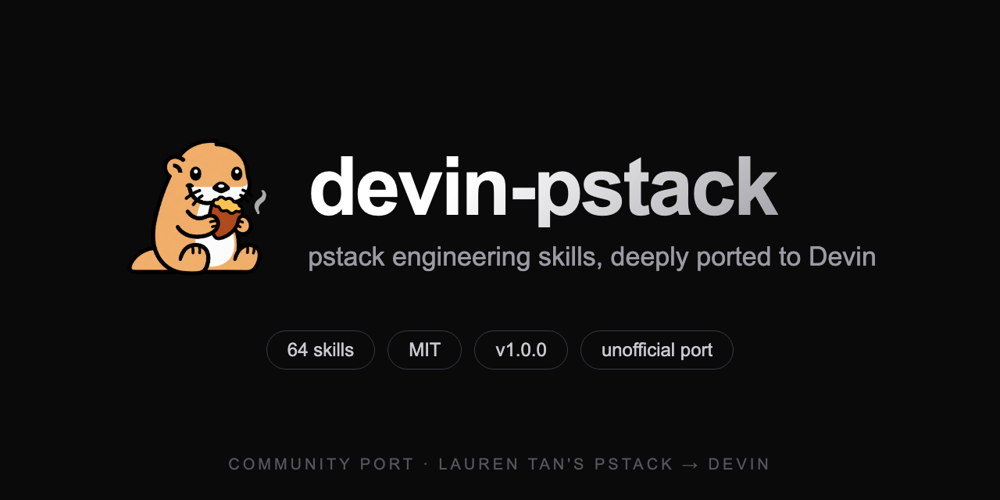

<p align="center">
  
</p>

<h1 align="center">devin-pstack</h1>

<p align="center">
  <b>Lauren Tan's <a href="https://github.com/cursor/plugins/tree/main/pstack">pstack</a> engineering skills, deeply ported to <a href="https://devin.ai">Devin</a>.</b><br>
  Install once — your Devin sessions work in her style: deliberate sub-agents, unslopped prose, verified claims.
</p>

<p align="center">
  
  
  
  
  
</p>

<p align="center">
  <i>Unofficial community port — not affiliated with Cognition or Cursor.</i>
</p>

---

## What is this?

[pstack](https://github.com/cursor/plugins/tree/main/pstack) is Lauren Tan ([@poteto](https://github.com/poteto))'s public set of agent skills for Cursor — 64 skills encoding how she works: fan-out sub-agents, adversarial review, slop removal, "prove it works" verification, and a set of named engineering principles.

**devin-pstack is not a find-and-replace port.** Every mechanism that exists only in Cursor has been rebuilt on the real Devin equivalent — child sessions, agent modes, reminders, automations, Devin Review, and the `git_*` tool family. Where Devin has no counterpart, the skill was redesigned rather than stubbed; where Devin has a *better* counterpart, the port takes advantage of it.

## Why run pstack on Devin?

Devin gives these skills capabilities they never had on Cursor:

| Capability | On Devin | On Cursor (upstream) |
|---|---|---|
| Sub-agent isolation | Each `devin_session_create` child gets its own VM and checkout | Shared workspace, manual worktree management |
| Cross-platform verification | `fleet` playbook fans the same change out to Windows/macOS/Linux children | Single-machine only |
| PR watching | `git_take_over_pr` streams review comments + CI events live | `watch-pr` polling scripts |
| Review triage | Devin Review findings feed a structured `triage → end_triage` loop | Bugbot scraping heuristics |
| Orchestration | `run_workflow` journals every agent call and resumes after crashes | Linear prompt chains |
| Long-running work | `devin_reminder_manage` RRULE schedules survive session sleep | `/loop` timer prompts |
| Automations | `devin_automation_manage` — schedules, webhooks, Slack/GitHub/Linear/Jira triggers with approval cards | Manual routines |

See [`docs/harness/devin.md`](docs/harness/devin.md) for the full adaptation table.

## Install

In any Devin session, say:

```text
install the plugin from github.com/Till3005/devin-pstack
```

Then once, in a session:

```text
/setup-pstack
```

`/setup-pstack` detects which Devin agent modes your account has and writes your role→mode mapping to `~/.devin/rules/pstack-models.md`. After that, start work with `/poteto-mode`.

## Quick start

| You say | What happens |
|---|---|
| `/poteto-mode ship this` | Runs the shipping playbook: draft-free PR, CI watch, review triage |
| `/swarm refactor the auth layer` | Fans N parallel workers out, drains them, returns one report |
| `/interrogate this design` | Multi-angle adversarial review before you commit to it |
| `/deslop` | Strips agent slop (dead comments, hedged prose, churn) from the diff |
| `/babysit PR 123` | Takes over the PR: conflicts → threads → CI, in that order |
| `/ketchup` | Plain-words recap of what changed since you last looked |

## What's inside

**64 skills total** — 61 core skills in `skills/`, plus 3 bundled in the benny automation pack — grouped by what they do for you:

<details open>
<summary><b>Orchestration & fan-out</b> — run many agents, one answer</summary>

| Skill | What it does |
|---|---|
| `poteto-mode` | The flagship: her agent style — concise, deliberate sub-agents, verified claims. Playbook runner. |
| `swarm` | Fan N workers at one task, drain, single report |
| `arena` | N parallel candidates, pick a base, graft the best of the losers |
| `fleet` *(new)* | Cross-platform verification: same change tested on Windows/macOS/Linux child sessions |
| `interrogate` | Adversarial multi-angle review of a plan or diff |
| `automate-me` | Turns your repeated instructions into a durable `-mode` skill |
| `poteto-help` | Guide to picking the right skill, playbook, or principle |
| `setup-pstack` | One-time role→agent-mode mapping |

Playbooks live under `skills/poteto-mode/playbooks/`: `shipping`, `babysit`, `autopilot-full`, `opening-a-pr`, `bug-fix`, `fleet`, `autonomous-run`, and more.
</details>

<details>
<summary><b>Verification & review</b> — prove it, don't claim it</summary>

| Skill | What it does |
|---|---|
| `control-ui` | Drive and verify a real UI — browser, Electron, web app — as a user would |
| `control-cli` | Same for CLIs and TUIs: flags, exit codes, output |
| `deslop` | Remove agent slop from a diff before it ships |
| `unslop` | Cut AI tells from any prose |
| `correct` | Find mistakes agents keep repeating; make each structurally impossible |
| `blast-radius` | What could this change break beyond the diff — with proof |
| `benchmark-checklist` | Vet a perf measurement before trusting it |
| `show-me-your-work` | Reviewable decision trail (TSV log) for unattended runs |
| `no-comments` | Spawn Comment Sicko; fix accepted findings; encode real constraints |
| `create-verification-skill` / `maintain-verification-skill` | Generate & keep honest a project-local verification skill |
| `create-formal-verification-skill` / `maintain-formal-verification-skill` | Same, for formal methods where a bug costs the most |
| `statechart` | Check a TLA+ model of a stateful system |
| `tdd` | Disciplined failing-test-first flow, on request |
| `typescript-best-practices` | TS standards applied while reading/editing .ts/.tsx |
</details>

<details>
<summary><b>Understanding & explanation</b> — know what you're touching</summary>

| Skill | What it does |
|---|---|
| `how` | How does X work — walkthroughs, placement, ownership |
| `why` | Design rationale, regressions, postmortems |
| `architect` | Sketch types/signatures/structure before code |
| `figure-it-out` | Design an auditable playbook for work with no narrower fit |
| `recall` | Reconstruct working context from session history (via `devin_session_*` tools) |
| `reflect` | Mine the transcript for durable learnings; route each to a concrete edit |
| `teach` | Explain a body of work so a person actually understands it |
| `bro` | Restate the last message in plain human language |
| `in-your-own-words` | Check alignment: restate the goal before doing the work |
| `ketchup` / `ketchup-video` | Catch you up on what changed since your last message |
| `technical-writing` | Diátaxis + Google-style + STE layered writing standard |
| `sharpen` | Make a task deeper, not bigger; rewrite the prompt |
</details>

<details>
<summary><b>Engineering principles</b> — 25 named judgment calls</summary>

`attack-the-premise`, `boundary-discipline`, `build-the-lever`, `encode-lessons-in-structure`, `exhaust-the-design-space`, `experience-first`, `explain-the-number`, `fix-root-causes`, `foundational-thinking`, `guard-the-context-window`, `laziness-protocol`, `make-operations-idempotent`, `migrate-callers-then-delete-legacy-apis`, `minimize-reader-load`, `model-the-domain`, `never-block-on-the-human`, `outcome-oriented-execution`, `prove-it-works`, `redesign-from-first-principles`, `separate-before-serializing-shared-state`, `sequence-verifiable-units`, `subtract-before-you-add`, `test-behavior-not-implementation`, `type-system-discipline`.

Each is a skill that fires at the moment its judgment applies — e.g. `laziness-protocol` when you're tempted to add abstraction, `explain-the-number` before trusting any measurement.
</details>

**Agents** — briefs for embedding in child-session prompts: `agents/poteto-agent.md`, `agents/comment-sicko.md`.

**Automations** — `automations/benny/`: a Slack bug-triage + reproduce-and-fix pack ported to `devin_automation_manage`, with its own 3 skills (`setup-benny`, `triage-issue-reports`, `reproduce-and-fix-issues`). Copy the pack into a target repo to use it.

**Docs** — start here:

| Doc | Contents |
|---|---|
| [`docs/guide/01-setup.md`](docs/guide/01-setup.md) … `10-recipes-and-pitfalls.md` | Ten walkthroughs: setup → poteto-mode → understand → design → build → verify → overnight runs → principles → customization → recipes |
| [`docs/harness/devin.md`](docs/harness/devin.md) | Full Cursor→Devin adaptation table + where Devin exceeds Cursor |
| [`docs/harness/other-harnesses.md`](docs/harness/other-harnesses.md) | Notes for running these ideas on other agents |

## Honest status

- ✅ All 64 `SKILL.md` files pass frontmatter validation; zero broken internal links.
- ✅ Every Cursor-specific mechanism (Task sub-agents, `/loop`, `/automate`, cloud agent, Custom Mode, `.cursor/` paths, transcript globbing, `origin pr`) has been replaced with a real Devin mechanism — audited file-by-file.
- ⚠️ **End-to-end install** (skill discovery after `install the plugin`) is verified to file-structure validity; one real install pass on your machine is the last check — report anything missing as an issue.
- ⚠️ The `benny` automation pack is documented and ported but hasn't run a live Slack trigger yet.

## Repository layout

```text
plugin.json                 # Devin plugin manifest (agent-plugins.org schema)
.cursor-plugin/             # Upstream pstack manifest, kept for provenance
skills/                     # 61 core skills (poteto-mode, swarm, principles, ...)
  poteto-mode/playbooks/    # shipping, babysit, autopilot, fleet, ...
agents/                     # poteto-agent, comment-sicko
automations/benny/          # Slack triage + reproduce-and-fix automation pack
docs/guide/                 # 10-part walkthrough
docs/harness/               # devin.md adaptation table
assets/logo.png             # otter eating a sweet potato
```

## FAQ

**Is this official?** No. Community port, MIT licensed like upstream. Cognition and Cursor are not affiliated.

**Will it track upstream?** pstack is Lauren's living skill set — upstream changes don't flow automatically. File an issue (or PR) with the upstream diff you want pulled in.

**Does it work in Devin on the web/CLI or only Desktop?** The plugin is a directory Devin loads; it works anywhere Devin sessions run, though the workflow assumes the full Devin tool surface (git tools, session tools, review).

## Contributing

Issues and PRs welcome — especially: upstream drift ports, more Devin-native playbooks, and verification reports on platforms you use.

## Credits

- **Lauren Tan ([@poteto](https://github.com/poteto))** — pstack, the skills, the style, and the sweet-potato-eating creature concept that the logo riffs on. [Upstream repo](https://github.com/cursor/plugins/tree/main/pstack).
- Devin port: [@Till3005](https://github.com/Till3005).

## License

[MIT](LICENSE) — same as upstream. Copyright (c) 2026 Lauren Tan.
